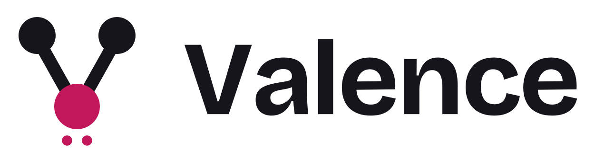
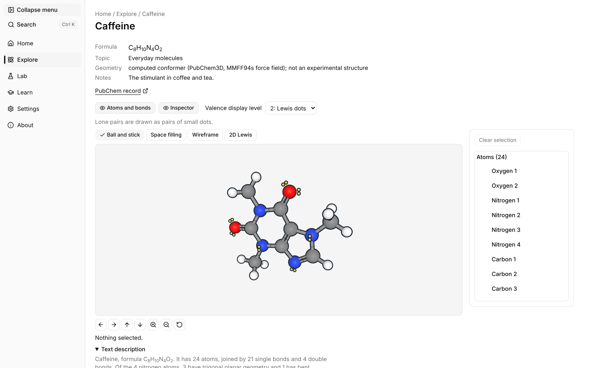
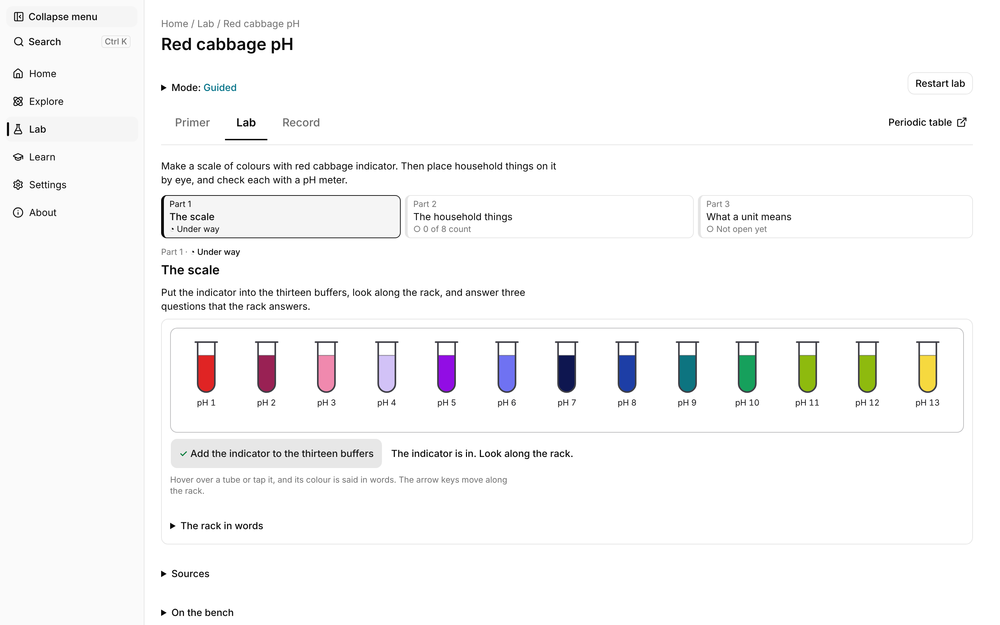
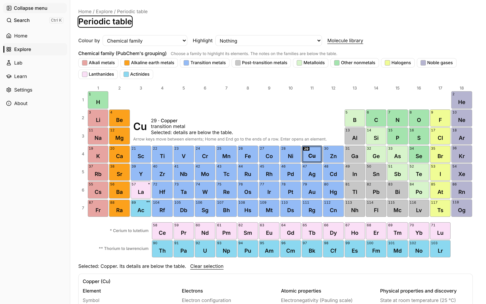
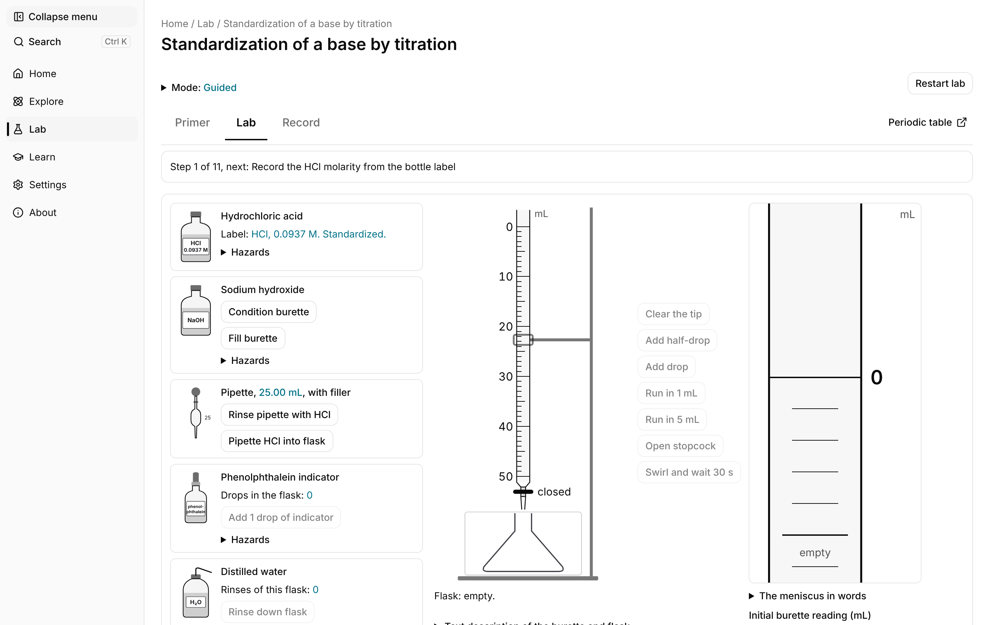
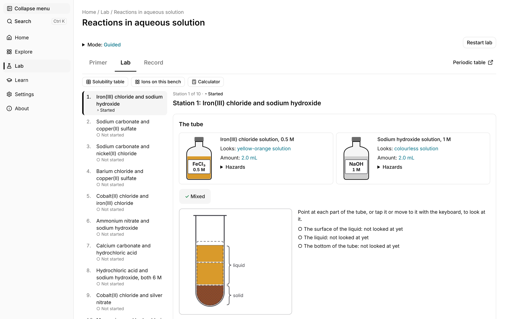
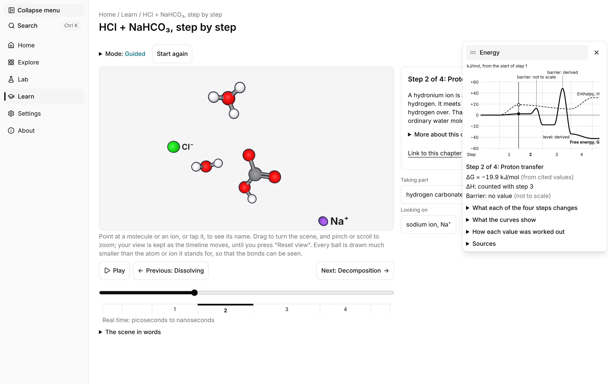
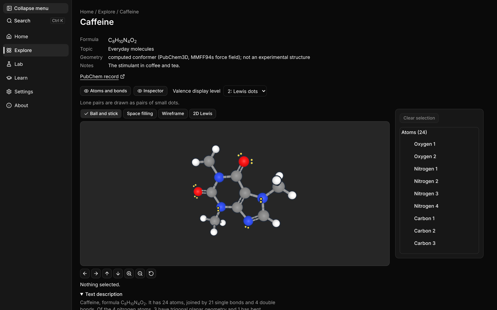
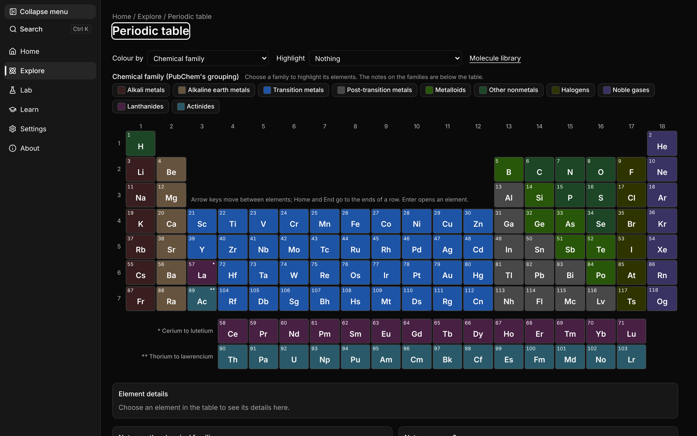

  <picture>
    <source media="(prefers-color-scheme: dark)" srcset="logos/valence-logo-on-dark.svg">
    
  </picture>

# Valence media kit

Logos, screenshots and descriptions for writing about Valence. Everything here is free to use in coverage of Valence.

- Try it: https://firetailfab.com/valence/#/
- Source: https://github.com/zebadrabbit/Valence

## Fact sheet

| | |
|---|---|
| Name | Valence |
| What it is | Browser-based molecule explorer and virtual general-chemistry lab |
| Price | Free |
| Licence | MIT, open source |
| Made by | Firetail Fab, an independent studio |
| Platform | Any modern browser. Labs need a window at least 768 px wide. |
| Accounts | None. Progress is saved in the browser. |
| Built with | React, TypeScript, Vite, three.js |
| Affiliation | A personal learning project with no connection to any school |

## Descriptions

**One line**

Valence is a free, open-source chemistry lab and molecule explorer that runs in the browser, with no account needed.

**Short paragraph**

Valence is a free, open-source molecule explorer and virtual general-chemistry lab that runs in any modern browser. Learners can turn 101 molecules in 3D, browse all 118 elements with sourced values, and work through 14 bench labs, from titration to flame tests, in a guided or a challenge mode. There are no accounts: progress stays in the browser.

**Full description**

Valence is a free, open-source molecule explorer and virtual general-chemistry lab for self-directed learners. It recreates the bench labs of a first chemistry course so that anyone with a browser can do them, understand the chemistry and check their own results.

The explorer shows 101 molecules in 3D and as Lewis structures, from water and VSEPR shapes to caffeine and vanillin, with a card for every atom and bond. A periodic table covers all 118 elements, and every value on it carries a source. Fourteen labs, including titration, calorimetry, flame tests, Le Chatelier's principle and a red cabbage pH scale, each run in a guided mode that checks every answer or a challenge mode that checks only when asked. A mechanism timeline follows hydrochloric acid and sodium hydrogen carbonate atom by atom, with an energy chart that marks which values are cited and which are derived.

Every chemistry value in Valence is cited, drawing on NIST, PubChem, CIAAW and the NBS thermodynamic tables. It needs no account, keeps progress in the browser, and is released under the MIT licence by Firetail Fab.

## Screenshots

2880 × 1800 PNGs in [`screenshots/`](screenshots/). Recapture them after UI changes with [`tools/capture-screenshots.mjs`](tools/capture-screenshots.mjs).

| | |
|---|---|
|  |  |
| Molecule explorer: caffeine | Red cabbage pH lab |
|  |  |
| Periodic table | Titration lab |
|  |  |
| Aqueous reactions lab | Mechanism timeline |
|  |  |
| Explorer, dark theme | Periodic table, dark theme |

## Logo

The mark is a bent molecule: two bonds form the V, and the central atom carries a lone pair, the valence electrons the app is named for.

| File | Use on |
|---|---|
| `logos/valence-logo.svg` / `.png` | light backgrounds |
| `logos/valence-logo-on-dark.svg` / `.png` | dark backgrounds |
| `logos/valence-mark.svg` / `.png` | light backgrounds, square spaces |
| `logos/valence-mark-on-dark.svg` / `.png` | dark backgrounds, square spaces |
| `logos/*-mono-black.*`, `logos/*-mono-white.*` | one-colour printing |
| `valence-social-card.png` | link previews (1200 × 630 at 2×) |

The wordmark is set in Bricolage Grotesque Bold and outlined in the SVGs, so no font is needed. Keep clear space of at least one outer atom's width. Please don't recolour the atoms, stretch or rotate the mark, add effects, or reset the wordmark in another font.

## Colours

| Name | Hex |
|---|---|
| Ink | `#17151C` |
| Paper | `#FBF9FB` |
| Cabbage pink | `#C2185B` |
| Cabbage pink, on dark | `#FF6FA3` |

The accent strip in the social card is the red cabbage indicator scale from pH 1 to 13: `#D81B3C #C2185B #E86AA0 #C9A3DD #8E44C9 #5C6BD6 #283593 #3F51B5 #00838F #2E9D4A #8BC34A #B5CC3A #ECD23F`.

## Writing about Valence

Please do:

- write the name as **Valence**, one word, capital V;
- describe it as free and open source under the MIT licence;
- link to https://firetailfab.com/valence/#/;
- credit it to Firetail Fab.

Please avoid:

- saying it is made by, endorsed by or used for credit at any school. It is an independent learning project;
- saying chemistry instructors have reviewed it. None has yet;
- calling it a replacement for hands-on lab work or lab safety training;
- describing it as a mobile app. It runs in the browser and the labs need a wider screen.

Questions and corrections: open an issue on GitHub.
